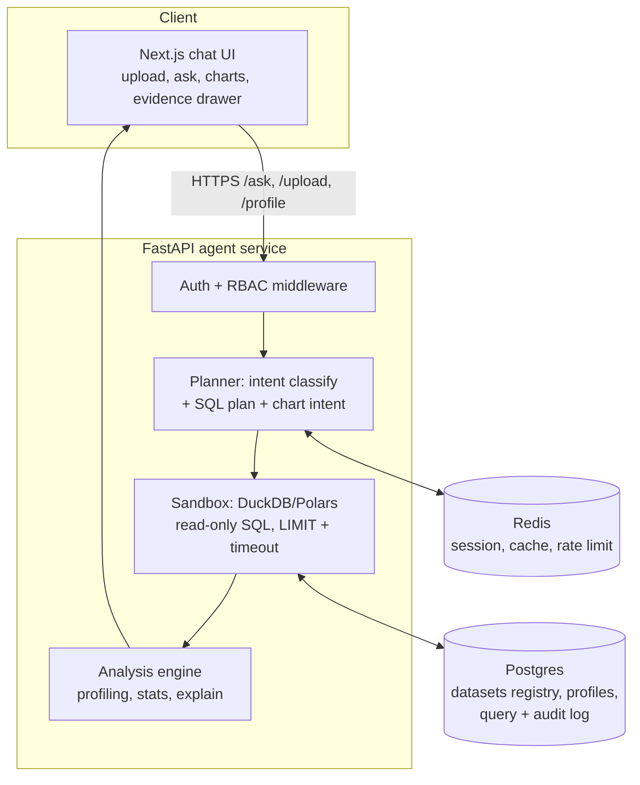
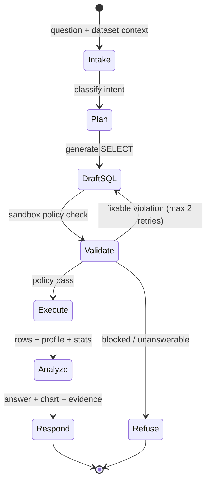

# InsightForge Architecture

## System diagram

## Agent state machine

States: **Intake → Plan → DraftSQL → Validate → Execute → Analyze → Respond**, with a bounded retry loop (2) and terminal **Refuse** (policy block, PII request, unanswerable with reason).

## Request flow: Question → Answer

1. **Question** arrives with session + dataset scope (`AskRequest`: question, dataset, maxRows).
2. **Auth/RBAC** resolves tenant + dataset permissions; PII columns flagged from profile.
3. **Planner** classifies intent (one of the 10 eval categories), picks tables/columns from the profile, drafts a single `SELECT … LIMIT n`.
4. **Sandbox** validates (allow-list: one SELECT/WITH on registered datasets; block-list: DDL/DML, system catalogs, stacked statements, unbounded `SELECT *`), executes in DuckDB with timeout + row cap.
5. **Analysis engine** (Polars) computes the requested aggregation plus profiling context (descriptives, correlations, outlier flags on demand).
6. **Responder** formats `AskResponse`: natural-language answer, SQL shown, result rows (capped), `ChartSpec` (bar/line/scatter/table heuristic), `EvidenceBundle` (dataset, filters, row sample, SQL), latency/tokens, warnings (PII masked, assumptions stated).

## Key decisions

- **DuckDB + Polars** for the hot path (in-process OLAP + frame ops, no extra service); **Postgres** for durable metadata/audit; **Redis** for session/cache/rate-limit.
- **Single-statement read-only SQL** keeps the security surface small and evals deterministic.
- **Evidence-first responses**: every numeric claim must trace to rows + SQL, which is what `evidence_correctness` and `hallucination_rate` measure.
- Slices: this repo slice owns **data + evals + docs**; `apps/web`, `apps/api`, `analytics`, `agents`, `sandbox`, `security`, `connectors`, `docker-compose.yml` are owned by other agents and intentionally untouched here.
