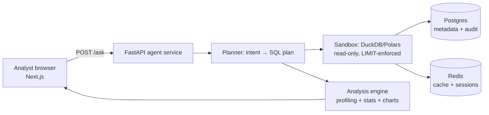

# InsightForge — Enterprise AI Data Analysis Agent

> Upload a spreadsheet. Ask questions in plain English. Get SQL-backed answers with charts and row-level evidence — in under 5 minutes.

InsightForge is a portfolio-grade, enterprise-style AI data-analysis agent: a Next.js chat UI backed by a FastAPI agent service that plans questions, runs **read-only sandboxed SQL** (DuckDB + Polars), profiles datasets, and returns answers with verifiable evidence bundles. Deterministic demo data, a 75+ question eval harness, and full docs ship in-repo.

**Resume-ready description:** Built an enterprise AI data-analysis agent (Next.js + FastAPI + DuckDB/Polars + Postgres/Redis) that converts natural-language questions into sandboxed SQL with profiling, statistical analysis, chart selection, and evidence citations; shipped deterministic multi-domain demo datasets (15k+ rows), an 80-question eval harness across 10 categories (accuracy, hallucination, latency, cost), and PII/RBAC security controls.

## Quickstart

```bash
git clone <repo-url> insightforge && cd insightforge
docker compose up --build
# web: http://localhost:3000   api: http://localhost:8000/docs
```

Seed demo data (no Docker needed):

```bash
python scripts/generate_demo_data.py
sh scripts/seed.sh
sh scripts/healthcheck.sh
```

Run evals:

```bash
python evals/run_evals.py
# -> evals/results.json + evals/EVALUATION_REPORT.md
```

## 5-minute demo

Follow **[docs/DEMO_SCRIPT.md](docs/DEMO_SCRIPT.md)** (steps 1–14): upload `sample-data/ecommerce.xlsx` → auto-profile → KPI query (*Q4 revenue up, profit down?*) → root-cause drill-down (discounts / shipping / returns) → evidence + chart. Companion UI walkthrough lives in `docs/DEMO.md` (owned by the app slice).

## Architecture



See [ARCHITECTURE.md](ARCHITECTURE.md) for the state machine and request flow.

## Datasets

| File | Rows | Grain | Demo pattern |
|---|---|---|---|
| `sample-data/ecommerce.xlsx/.csv/.parquet` | ~5,000 | order (2023–2024) | Q4 2024: revenue ↑, profit ↓ (discounts ~25%, returns ~14%) |
| `sample-data/saas.csv` | ~3,000 | subscription | Basic churn ~22% vs Enterprise ~4% |
| `sample-data/cloud_spend.json/.parquet` | ~4,000 | service-day | SageMaker/ML/prod spike, Nov 2024 |
| `sample-data/manufacturing.parquet/.csv` | ~3,500 | line-shift-day | L3/Night defect spike Q3 2024 (6–9%) |

Regenerate deterministically: `python scripts/generate_demo_data.py --seed 42`.

## Evals

80 questions across 10 categories (`evals/eval_questions.json`): simple_lookup, aggregation, multi_step, time_comparison, root_cause, correlation, outlier, ambiguous, unanswerable, security. Metrics: sql_validity, execution_rate, numeric_accuracy, correctness, completeness, chart_correctness, evidence_correctness, hallucination_rate, latency, token_cost. Details: [docs/EVALUATION.md](docs/EVALUATION.md).

## Screenshots

> Screenshot placeholders (app slice owns `apps/web`): 1) upload + auto-profile, 2) KPI answer with line chart, 3) root-cause answer with evidence drawer, 4) eval report excerpt.

## Docs

- [ARCHITECTURE.md](ARCHITECTURE.md) — system + agent state machine
- [docs/DATA_SECURITY.md](docs/DATA_SECURITY.md) — auth, RBAC, PII, audit
- [docs/ANALYSIS_ENGINE.md](docs/ANALYSIS_ENGINE.md) — DuckDB/Polars pipeline
- [docs/SQL_SANDBOX.md](docs/SQL_SANDBOX.md) — sandbox policy
- [docs/EVALUATION.md](docs/EVALUATION.md) — eval design + how to run
- [docs/DEMO_SCRIPT.md](docs/DEMO_SCRIPT.md) — 5-min demo steps 1–14

## Contracts

Shared DTOs: [`packages/contracts/dtos.ts`](packages/contracts/dtos.ts) / [`schemas.json`](packages/contracts/schemas.json) (`AskRequest`, `AskResponse`, `DatasetProfile`, `EvidenceBundle`, `ChartSpec`).
